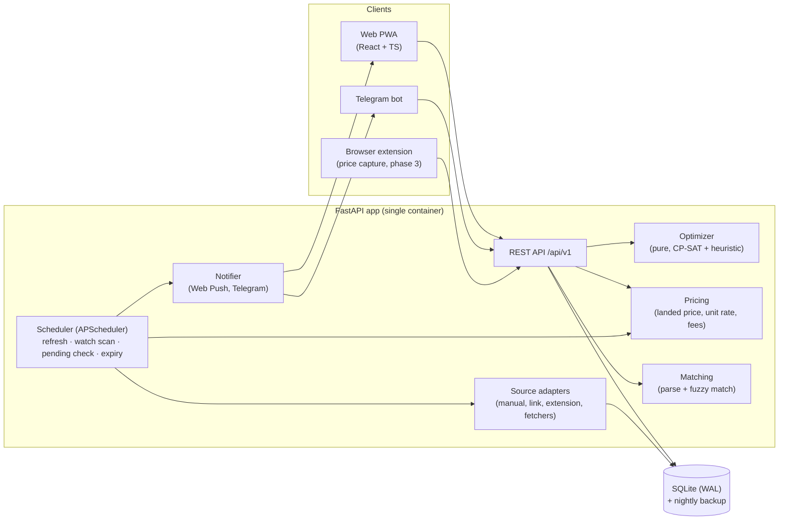
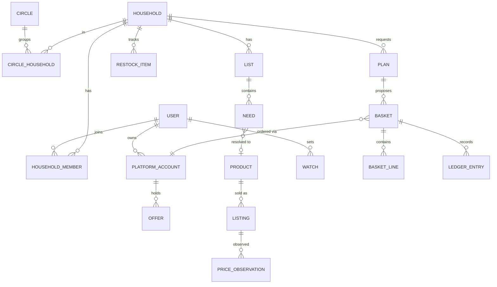

# Architecture

*Status: Target design v1 · 2026-10-18. Nothing below is built yet. The prototype is described in `CODE_ANALYSIS.md`.*

## 1. Shape

A small, self-hosted, three-part app sized for one person plus about 15 family and friends.



There is one process and one database. No message queue, Redis or microservices. See ADR-002, ADR-003 and ADR-014.

## 2. Components

| Component | Responsibility | Must not |
|---|---|---|
| **api** | Auth, validation, orchestration. Loads data → builds `PlanRequest` → calls optimizer → persists `Plan`. | Contain pricing or optimization math |
| **pricing** | Fee schedules, membership effects, unit normalisation (g/ml/pcs → per kg / L / 100 g / piece), landed line price | Know about orders beyond fee schedules |
| **optimizer** | `plan(PlanRequest) -> PlanSet`. CP-SAT model, heuristic fallback, explanations | Do I/O or read the clock (`today` is passed in) |
| **matching** | Free text → `Need` (qty, unit, pack, brand). Need ↔ Product fuzzy match. URL → platform + product id | Fall back to an arbitrary product |
| **sources** | Adapters producing `PriceObservation`s with provenance | Log in, solve CAPTCHAs, ignore rate limits |
| **jobs** | Scheduled, idempotent tasks | Run anything twice concurrently (job-level lock row) |
| **notify** | Fan-out alerts with dedupe, cooldown and quiet hours | Send without user opt-in |
| **web** | Display, input, offline list capture | Compute prices or plans |

## 3. Repository layout (target)

```
deal-scour/
├── AGENTS.md  CLAUDE.md  README.md
├── docs/                      PRD, ARCHITECTURE, FLOW, BASKET_OPTIMIZER, DECISIONS, CODE_ANALYSIS, ROADMAP
├── prototype/                 dealscour_v3.html, deal_scour_backend.py  (moved here in Phase 0, read-only)
├── backend/
│   ├── pyproject.toml         (pip/venv; fastapi, sqlmodel, alembic, ortools, apscheduler, httpx, rapidfuzz, pywebpush)
│   ├── app/
│   │   ├── main.py
│   │   ├── core/              config.py, db.py, auth.py, money.py (paise helpers), clock.py
│   │   ├── domain/            platform.py, product.py, listing.py, offer.py, need.py, basket.py, household.py
│   │   ├── pricing/           fee_schedules.py, landed.py, units.py
│   │   ├── optimizer/         contract.py, offers.py, evaluate.py (scorer), planning.py, baseline.py, heuristic.py,
│   │   │                      pending.py (pending + fillers), explain.py (reasons), planset.py (entry point); CP-SAT deferred (ADR-023)
│   │   ├── matching/          parser.py, matcher.py, url_parser.py, llm_parser.py (optional)
│   │   ├── sources/           base.py, manual.py, link.py, extension.py, amazon_paapi.py, fetchers/<platform>.py
│   │   ├── jobs/              scheduler.py, refresh_prices.py, scan_watches.py, check_pending.py, offer_expiry.py, restock_due.py
│   │   ├── notify/            base.py, telegram.py, webpush.py
│   │   └── api/v1/            needs.py, lists.py, products.py, prices.py, offers.py, plans.py, baskets.py, watches.py, households.py, ledger.py
│   ├── migrations/
│   └── tests/                 optimizer/ (golden + property), pricing/, matching/, sources/ (fixtures), api/
├── web/
│   ├── package.json           (vite, react, typescript, tanstack-query, tailwind, vite-plugin-pwa)
│   └── src/
│       ├── app/               router, auth, layout, theme
│       ├── lib/               api client (generated from OpenAPI), formatINR, dates
│       └── features/          list/, deals/, plans/, baskets/, offers/, wishlist/, ledger/, household/, settings/
├── extension/                 (phase 3) MV3 extension: content scripts per platform → POST /prices/capture
├── deploy/                    docker-compose.yml, Caddyfile, backup.sh
└── .env.example
```

## 4. Data model

SQLite, all money in paise (`INTEGER`), all timestamps UTC ISO-8601. Names below are tables.



| Table | Key columns |
|---|---|
| `user` | id, name, email, telegram_chat_id?, webpush_subscription?, quiet_hours, created_at |
| `household` | id, name, pincode, address_label, timezone (Asia/Kolkata) |
| `household_member` | household_id, user_id, role (`owner`/`member`/`viewer`) |
| `circle`, `circle_household` | id, name · circle_id, household_id |
| `platform_account` | id, user_id, platform, label ("Deepak's Amazon"), memberships JSON {prime: {active, expires_on}}, payment_methods JSON ["hdfc_cc", "icici_amazon_pay_cc"] |
| `fee_schedule` | platform, pincode?, valid_from, delivery_fee, free_delivery_min, member_free_delivery_min, handling_fee, platform_fee, small_cart_below, small_cart_fee (user-editable, versioned) |
| `product` | id, canonical_name, brand, category, pack_qty, pack_unit (`g`/`ml`/`pc`), variant, perishable_days?, aliases JSON |
| `listing` | id, product_id, platform, platform_sku, url, pincode, max_qty_per_order? |
| `price_observation` | id, listing_id, price, mrp, member_price?, in_stock, eta_minutes, source (`manual`/`link`/`extension`/`fetcher`/`paapi`/`sample`), observed_by_user_id?, observed_at |
| `offer` | id, platform_account_id, kind, params JSON (validated per kind), stack_group, value_type, multiplier_bp, valid_from, valid_to, period (`order`/`day`/`month`/`lifetime`), uses_total, uses_left, visibility (`private`/`household`/`circle`), source_note |
| `list` | id, household_id, name, kind (`quick`/`monthly`/`event`), archived |
| `need` | id, list_id, raw_text, product_id?, generic_query?, qty, flex_brand, flex_pack, need_by?, urgent, lock_platform?, status (`open`/`planned`/`in_basket`/`bought`/`dropped`), added_by |
| `restock_item` | id, household_id, product_id, cadence_days, last_bought_on, typical_qty, auto_learned |
| `watch` | id, user_id, product_id or generic_query, target_price?, target_unit_rate?, min_discount_pct?, rule (`any`/`all`), channels, cooldown_hours, last_alerted_at |
| `plan` | id, household_id, request_json, result_json, solver_status, created_at, chosen_label? |
| `basket` | id, household_id, plan_id?, platform, platform_account_id, status (see FLOW §4), target_offer_ids, threshold, deadline?, placed_at?, actual_paid?, offer_value_expected, offer_value_received?, pooled_with_basket_id? |
| `basket_line` | basket_id, need_id?, listing_id, qty, price_snapshot, is_filler, owner_household_id |
| `ledger_entry` | id, household_id, basket_id, kind (`paid`/`cashback_expected`/`cashback_received`/`cashback_missed`/`settle_up`), amount, counterparty_household_id?, at |
| `notification` | id, user_id, kind, dedupe_key UNIQUE, payload, channel, sent_at |
| `job_run` | job, started_at, finished_at, status, stats JSON (lock and audit) |

**Current price** is a view: the latest `price_observation` per listing, with `age = now − observed_at`. Freshness bands:
`fresh` < 6 h, `ok` < 48 h, `stale` beyond that. Quick-commerce prices go stale faster (the threshold is configurable per platform).

## 5. Source adapters

```python
class SourceAdapter(Protocol):
    platform: Platform
    capabilities: set[Literal["link_parse", "search", "refresh", "capture"]]
    async def parse_link(self, url: str) -> ListingDraft | None: ...
    async def refresh(self, listings: list[Listing], pincode: str) -> list[PriceObservation]: ...
```

| Adapter | Phase | How | Notes |
|---|---|---|---|
| `manual` | 1 | User types price/MRP/ETA | Always available; fastest to build; family members can all contribute |
| `link` | 1 | Parse URL for platform + SKU; best-effort page title/pack extraction | No login; one request per paste |
| `extension` | 3 | MV3 content script reads the price DOM on pages *the user is already viewing* | Most robust and ToS-friendly way to get real quick-commerce prices for your pincode |
| `amazon_paapi` | 3 | Amazon Product Advertising API | Requires an Associates account that meets eligibility; optional |
| `fetchers/<platform>` | 3 | httpx/Playwright, **watched items only**, ≤ 1 req / 10 s / platform, jittered | Opt-in per platform, off by default. Disabled automatically after 3 consecutive failures |

## 6. API (v1 sketch)

All endpoints are under `/api/v1` and scoped to the caller's household unless noted. The OpenAPI schema generates the TS client.

| Method & path | Purpose |
|---|---|
| `POST /auth/request-code`, `POST /auth/verify` | Email OTP sign-in (invite-only) |
| `GET/POST /lists`, `POST /lists/{id}/quick-add` `{text}` | Lists; quick-add parses free text into needs |
| `PATCH /needs/{id}` | qty, flex flags, need_by, urgent, lock_platform, status |
| `GET /products?q=` · `POST /products` | Catalog search / create |
| `POST /listings/from-link` `{url}` | Paste a link → listing draft |
| `POST /prices` · `POST /prices/capture` | Manual price · extension capture |
| `GET /deals?category=&platform=&sort=` | Deal grid (landed price + unit rate, membership-aware) |
| `GET/POST/PATCH /offers` | Offer Wallet |
| `POST /plans` `{list_ids?, need_ids?, settings?}` → `PlanSet` | **Run the optimizer** |
| `POST /plans/{id}/accept` `{label}` | Turn the chosen plan into baskets (`ready` or `pending`) |
| `GET /baskets?status=` · `PATCH /baskets/{id}` | Pending dashboard; add/remove lines, set deadline |
| `GET /baskets/{id}/fillers` | Ranked filler suggestions |
| `POST /baskets/{id}/place` `{actual_paid}` · `POST /baskets/{id}/cashback` `{received}` | Reconciliation |
| `POST /baskets/{id}/pool` `{other_basket_id}` | Pool with a circle member's basket |
| `GET/POST /watches` | Wishlist |
| `GET /ledger/summary?month=` | Savings dashboard |
| `POST /telegram/webhook` | Bot updates (`/add`, `/list`, `/plan`, `/pending`) |

## 7. Scheduled jobs

| Job | Default schedule | What it does |
|---|---|---|
| `refresh_prices` | every 2 h, 07:00–22:00 IST | Refresh watched and in-basket listings through enabled adapters |
| `scan_watches` | after each refresh, plus hourly | Evaluate watch rules → notifications (deduped by `watch_id:price_bucket:day`) |
| `check_pending` | every 30 min | Recompute shortfall, re-home suggestions, deadline nudges (T-48 h, T-12 h) |
| `offer_expiry` | daily 09:00 | Remind about expiring offers that have usable pending baskets |
| `restock_due` | daily 08:00 | Raise restock needs and refresh filler pools |
| `backup` | daily 03:00 | `sqlite3 .backup` → rotated local copy (+ optional rclone to Google Drive) |

## 8. Security & privacy
- Invite-only. Email OTP sessions in HTTP-only cookies. Household scoping is enforced in one dependency (`require_household`).
- No platform credentials stored, ever (ADR-020). Payment methods are stored as labels only ("HDFC credit card"), never numbers.
- All rendering is escaped. Strict CSP with no inline scripts in the PWA.
- Secrets live in `.env`. The Telegram webhook is checked with a secret token header.
- A family member can export or delete their data (one JSON export endpoint).

## 9. Deployment
- `docker compose up` runs `app` (FastAPI + static web build) and `caddy` (TLS). Run it on a ₹300–500/month VPS, a home mini-PC behind
  Tailscale/Cloudflare Tunnel, or a free-tier VM.
- A single SQLite file on a volume, plus nightly backup. Postgres becomes an option when more than one writer process is needed (ADR-003).
