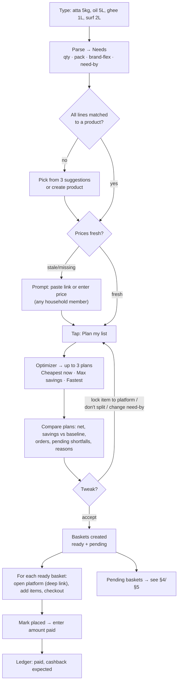
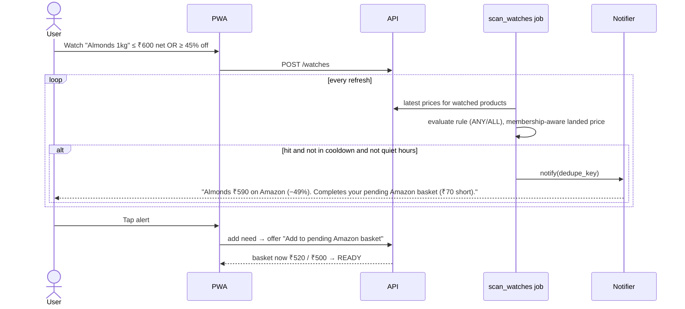
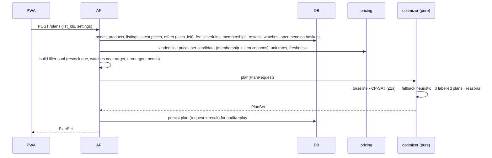
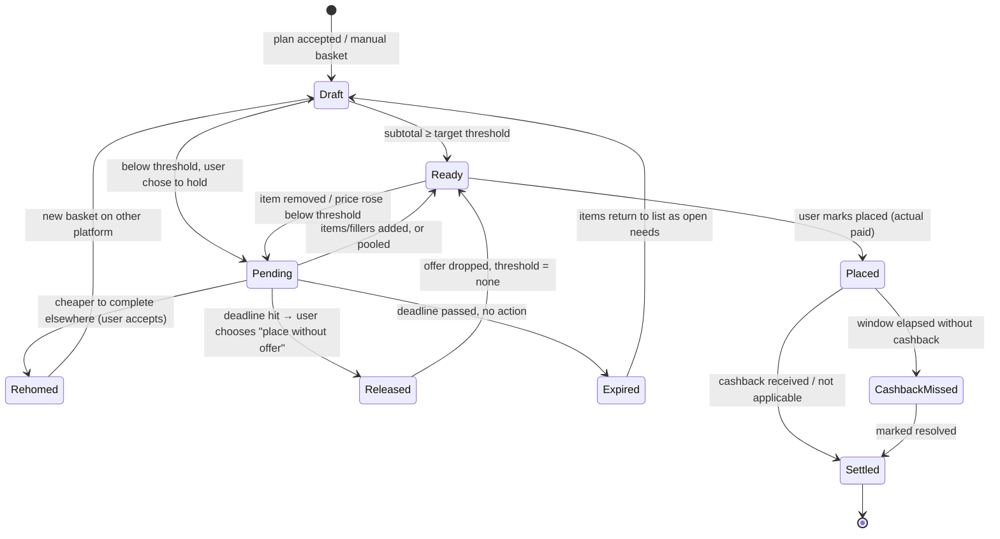
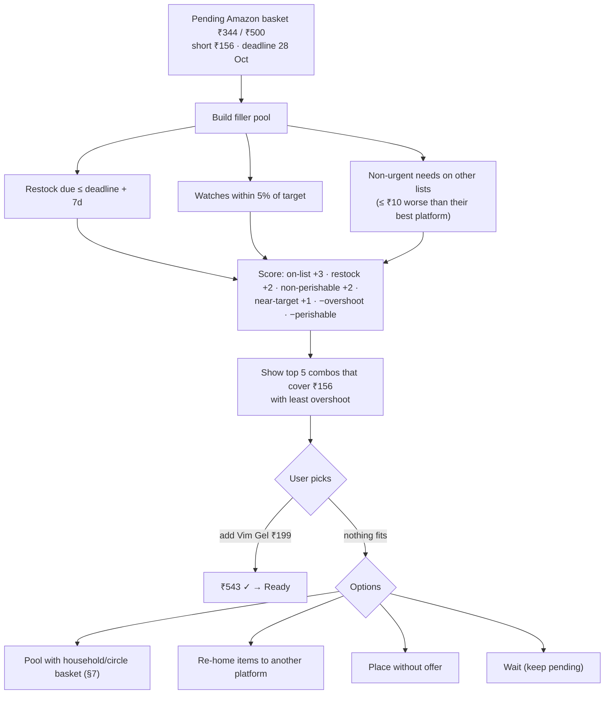
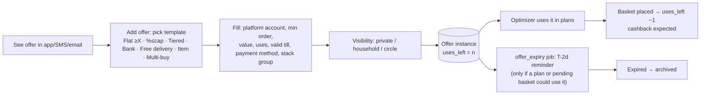
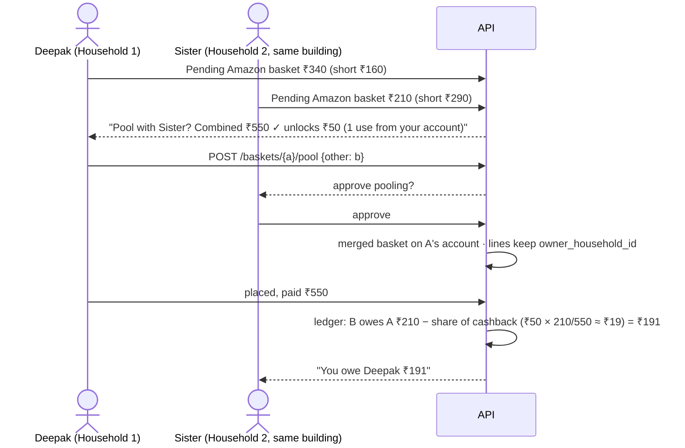
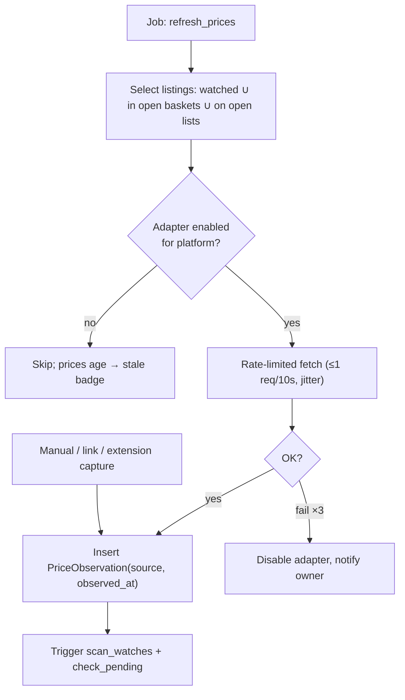
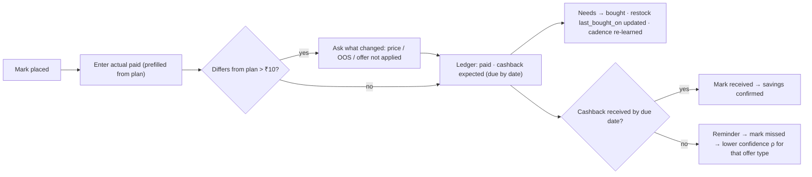
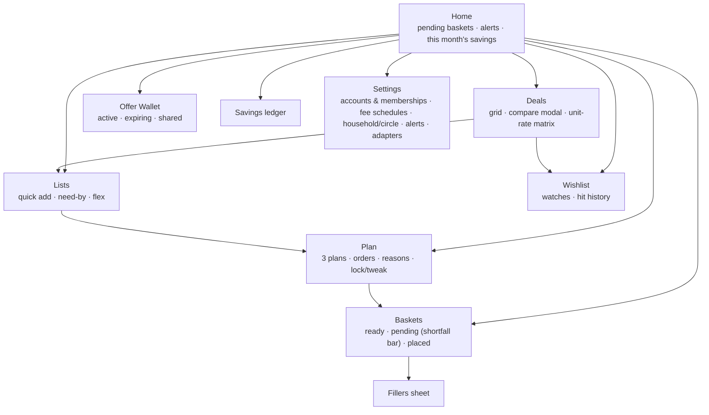

# Flows

*User flows and system flows. Status: Design v1 · 2026-10-18*

Contents
1. Quick list → plan → order (the main loop)
2. Wishlist watch → alert → basket
3. Optimizer request (system sequence)
4. Pending basket lifecycle (state machine)
5. Filling a pending basket
6. Offer Wallet: add, use, expire
7. Household & circle: share, pool, settle up
8. Price refresh & freshness
9. Post-order reconciliation & savings ledger
10. Screen map

---

## 1. Quick list → plan → order

**UX notes**
- The plan screen leads with **one number**: "₹1,239 total · save ₹50 vs one order". Details expand from there.
- Each order card shows `₹674 / ₹500 ✓ ₹50 cashback` or `₹344 / ₹500 · ₹156 short ⏳`.
- The checkout helper shows a checklist of items with pack sizes, so the person checking out doesn't buy the wrong 1 kg vs 5 kg.

## 2. Wishlist watch → alert → basket

Matching rule: a watch on a **product** matches only that product's listings. A watch on a **generic need**
("almonds 1 kg, any brand") matches products in that category whose pack is within ±20% and whose unit rate is compared.
No keyword "any word matches" logic (prototype bug, see CODE_ANALYSIS §4).

**Built so far (staples tracker):** a watch is a `listing_watch` row on one listing, with an optional target (`PUT /listings/{id}/watch`).
`GET /deals/feed` lists watched or custom listings that are in stock with a fresh/ok, non-sample price and at least one reason:
`below_target`, `low_30d` (≥ 3 observations in 30 days, the price has moved, and it's at the low) or `under_avg` (≥ 15% under the 30-day
average, integer maths). The web shows it as the **Deals** tab. Adding a product: paste a link → `POST /listings/autofill` reads the
Amazon/Flipkart page once (10 s apart from any other fetch), fills brand/pack/family by rules and, only if something is still missing,
one capped Gemini call → the user confirms and saves. Quick-commerce links are never fetched.

**Catalog → Find on shops:** "Add an item…" on the Plan page also searches `catalog_product`. A catalog need shows **Find on shops**: the
server builds 5 shop search URLs (`GET /catalog/{id}/search-urls`); the extension opens each one in a background tab (only those 5 search
shapes, only for a request from the DealScour origin, one search at a time, ≥ 3 s apart, 20 s timeout), reads up to 5 product links per shop
and closes the tab. `POST /catalog/{id}/candidates` drops non-product links and sorts by brand/pack/name words for display only. The owner ticks
the right ones → normal `POST /listings`. Nothing is tracked without the tick.

**Deal radar (ADR-026):** Telegram Web tab → extension reads only listed channels → `POST /radar/posts` (extension token) stores them
`pending` → every 60 s the radar loop resolves links, drops posts that match no keyword or tracked family (post text + URL slug) without
fetching, checks the live price for the rest, and decides `good`/`expired`/`not_relevant`/… → a good one becomes a `radar_alert`: Telegram
message from the owner's bot (held in quiet hours, India time) and a Chrome notification (the extension polls `/radar/alerts` every 2 min).
The Radar page lists channels, keywords and the last 50 posts with their verdicts. Deals shows a "From Telegram" section.

## 3. Optimizer request (system sequence)

Replays: any stored plan can be re-run from `request_json`. This is how bugs are reported and turned into golden tests.

## 4. Pending basket lifecycle

**Nudges**
- On entering `Ready`: "Your Amazon basket is ₹515. Place it to get ₹50."
- `Pending` at T-48 h and T-12 h before the deadline: "₹120 short. Top fillers: Vim Gel ₹199 (due), Tata Tea ₹240 (on list)."
- Price drop on an item already in a pending basket: no alert unless it changes `Ready`/`Pending` status.

## 5. Filling a pending basket

Combos are found with a small subset-sum over the pool (≤ 30 candidates). The search minimises overshoot, then maximises score.

## 6. Offer Wallet: add, use, expire

Shared offers: when a circle member shares "Amazon ₹50 on ₹500", others get a **"Do you have this too?"** prompt.
Confirming creates *their own* instance on *their own* account. Uses are never shared.

## 7. Household & circle: share, pool, settle up

Rules
- Pooling only happens across a **shared delivery address** or with an explicit "I'll hand it over" confirmation.
- Cashback is split pro rata by line value by default. The option is configurable to "orderer keeps cashback".
- Settle-up is a ledger entry and a UPI deep link (`upi://pay?...`). The app never moves money.

## 8. Price refresh & freshness

**Browser extension (optional, ADR-025).** Plans → "Check live prices and plan" sends the list's product links to the extension. It opens each one in a
background tab (≤ 15 per run, ≥ 8 s apart per shop), reads the price only from Amazon's price block or the page's JSON-LD, and posts it to
`POST /prices/capture` (`source = "extension"`). A price more than 60% off the last one is listed under "Check these prices" for the user to
confirm or skip; the rest carry on. "Add to cart" on a ready basket opens the extension's confirmation window; after "Add N items" it opens each
product page, clicks add-to-cart once if the page is that product, and leaves the last tab on the shop for the human to check out.

## 9. Post-order reconciliation & savings ledger

Dashboard: **This month**: MRP ₹8,420 · paid ₹6,910 · offers captured ₹410 · cashback pending ₹100 · vs naïve plan +₹230.

## 10. Screen map

The prototype's tabs map as follows: *Deals* → Deals, *Matrix* → Deals ▸ Compare, *Cart* → Plans/Baskets (rebuilt),
*Alerts* → Wishlist, *Architecture* → removed (dev docs live in `docs/`).
